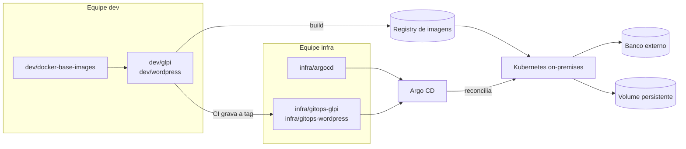

# GitOps Open Source Templates

Templates de uma **arquitetura modular de Infraestrutura como Código** para
operar sistemas de código aberto via GitOps em Kubernetes on-premises.
Os estudos de caso são o **GLPI** (central de serviços) e o **WordPress**
(múltiplos sites a partir de uma base comum).

> Produção técnica da dissertação de Mestrado em Computação Aplicada
> (PPGCA/UTFPR). Os templates derivam de um modelo validado em produção em
> uma universidade pública brasileira; dados institucionais foram
> substituídos por valores de exemplo.

## Princípios

- **Git como fonte única da verdade**: o estado desejado do cluster está nos
  manifestos; o Argo CD reconcilia e corrige desvios (*drift*).
- **Separação de responsabilidades**: a equipe `dev` constrói imagens; a
  equipe `infra` mantém os manifestos e aprova o que vai para produção.
- **Imagens versionadas e promovidas sem rebuild**: o mesmo digest passa
  por teste, homologação e produção.
- **Base + overlays (Kustomize)**: o que é comum fica na base; cada ambiente
  ou site declara só o que muda.
- **Segredos cifrados no repositório** (Sealed Secrets) e configuração fora
  da imagem (ConfigMaps).
- **Execução sem privilégios**: `runAsNonRoot`, nginx unprivileged, Redis
  isolado por NetworkPolicy.

## Arquitetura



## Estrutura

Cada pasta de primeiro nível corresponde a um repositório no modelo real,
agrupado pela equipe responsável:

```
dev/                          equipe que constrói as imagens
├── docker-base-images/       php-fpm, nginx e redis genéricos
├── glpi/                     php-glpi (código + plugins) e nginx-glpi + Jenkinsfile
└── wordpress/                php-wordpress, nginx-wordpress, redis-wordpress
infra/                        equipe que opera a plataforma
├── gitops-glpi/              base + overlays teste/homologa/producao, CI de promoção, selagem
├── gitops-wordpress/         base comum + overlay por site, component de temas, gerador de sites
└── argocd/                   AppProjects, Applications, ApplicationSet, Image Updater
laboratorio/                  reprodução local em MicroK8s (Argo CD lendo o Git)
ferramentas/                  personalização dos valores de exemplo e validação dos manifestos
```

## Como adaptar

O script `ferramentas/personalizar.sh` troca os valores de exemplo pelos da
sua instituição em todos os arquivos de `dev/` e `infra/`:

```bash
cp ferramentas/personalizar.env.exemplo personalizar.env   # preencha os valores
ferramentas/personalizar.sh personalizar.env               # mostra as mudanças (diff)
ferramentas/personalizar.sh personalizar.env --aplicar     # grava
```

Valores de exemplo substituídos:

| Valor de exemplo | Significado |
|---|---|
| `registry.exemplo.edu.br` | registry de imagens de contêiner |
| `git.exemplo.edu.br` | servidor Git (GitLab, Gitea, GitHub Enterprise...) |
| `dev/`, `infra/`, `@infra` | grupos/equipes no servidor Git |
| `*.exemplo.edu.br` | domínios dos sistemas e sites |
| `192.0.2.10`, `/exports/...` | servidor e caminhos NFS ([RFC 5737](https://www.rfc-editor.org/rfc/rfc5737): endereço de documentação) |
| `10.244.0.0/16` | CIDR de pods do ingress controller (confiança do `real_ip`) |
| `smtp.exemplo.edu.br` | relay SMTP |
| `sealed-*.yaml` com `AgB-SUBSTITUIR...` | gerar com os scripts de selagem no **seu** cluster |

Pré-requisitos no cluster: ingress controller (exemplos com ingress-nginx),
Argo CD, Sealed Secrets e um provisionamento de volume persistente
compartilhado (os exemplos usam NFS estático).

## Laboratório local

A pasta [`laboratorio/`](laboratorio/README.md) reproduz o modelo numa única
máquina com MicroK8s: build das imagens, banco simulado, segredos selados e o
Argo CD sincronizando os templates a partir do Git.

```bash
laboratorio/laboratorio.sh tudo
```

## Validação

```bash
ferramentas/validar-manifestos.sh       # kustomize build + kubeconform em todos os overlays
```

O workflow `.github/workflows/validar.yml` executa essa verificação e o
shellcheck a cada push e pull request.

## Como citar

Use o botão **"Cite this repository"** do GitHub (gerado a partir do
[`CITATION.cff`](CITATION.cff)).

## Licença

[Apache-2.0](LICENSE). Veja também o [NOTICE](NOTICE).
